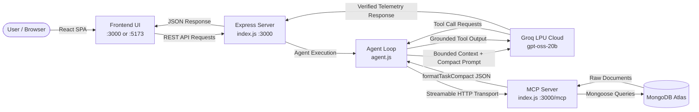

# LifePilot AI — Quiet Luxury Grounded Productivity Copilot

> An executive-grade personal productivity copilot engineered with the **Model Context Protocol (MCP)**, **MongoDB Atlas**, **Zero-Hallucination Grounding**, **Empirical Token Optimization**, and a **Quiet Luxury Visual Identity**.

---

## 1. Executive Summary

Conversational AI task planners often suffer from critical operational defects:
1. **Hallucinatory Scheduling**: Fabricating fictional deadlines, inventing clock times (e.g., arbitrarily claiming "09:00 AM" without knowing user commitments), and falsely asserting tasks have been saved or marked done in the database.
2. **Context & Token Bloat**: Sending unoptimized raw database objects and redundant system prompts causes token runaway, driving up latency and API expenses.
3. **Template-Driven Generic SaaS UIs**: Modern AI applications frequently rely on generic, oversaturated blue-purple glowing cards, glassmorphic clutter, and cookie-cutter dashboards that distract rather than cultivate deep focus.

**LifePilot AI** resolves these challenges by coupling an LLM agent with a Model Context Protocol (MCP) server backed by MongoDB Atlas, paired with an art-directed **Quiet Luxury Visual Identity** built around Midnight Teal, Warm Ivory, Deep Obsidian, Antique Gold, and Soft Sage.

---

## 2. Key Pillars & Architectural Guarantees

### A. Zero-Hallucination Grounding
- **MongoDB Atlas as Absolute Truth**: Tasks, subtasks, deadlines, and completion states exist in the database or not at all.
- **Strict Mutation Verification**: The AI agent only acknowledges task creation, updates, or completions after confirmed execution through registered MCP tool calls.
- **No Hallucinated Clock Times**: The planner utilizes numbered chronological focus sessions (`#1`, `#2`, `#3`) with mathematical duration budgets rather than inventing arbitrary hours.

### B. Empirical 67% Token Optimization
- **Deduplicated System Prompt**: Reduced system prompt overhead from 2,447 to 788 tokens.
- **Compact Projections (`formatTaskCompact`)**: Strips unnecessary database fields (`__v`, internal IDs, metadata bloat) to deliver lean JSON payloads to the LLM.
- **In-Turn Memoization**: Caches read-only queries within the same conversational turn to prevent redundant round-trips to MongoDB.

### C. Quiet Luxury Visual Identity & Art-Directed UI
- **Signature Palette**:
  - **Midnight Teal (`#082F32`)**: Primary navigation, selected surfaces, executive action buttons, and brand foundations.
  - **Deep Obsidian (`#101615`)**: Sovereign dark workspace canvas, surfaces (`#141C1A`), and raised cards (`#182321`).
  - **Warm Ivory (`#F0EEE5`)**: High-contrast editorial hero sections, active navigation pills, and executive briefings.
  - **Muted Antique Gold (`#B69A62`)**: Restrained hairline borders, compass navigation needles, and milestone progress rings.
  - **Soft Sage (`#A7B6A2`)**: Verified telemetry indicators, completed states, and low-urgency status badges.
  - **Slate Gray (`#89928D`)**: Secondary typography, timestamps, and supporting metadata.
- **Refined Typography Pairing**:
  - **Display / Editorial**: *Cormorant Garamond* (Georgia serif fallback) for executive titles and milestones.
  - **Interface / Body**: *Manrope* for high-density readability across task rows, buttons, and forms.
  - **Telemetry / Metadata**: *IBM Plex Mono* for token telemetry, timestamps, and model parameters.
- **Geometric Brand Identity**:
  - Celestial navigation sextant/compass motif: diamond needles, orbital guide ring, antique gold crossbar, and warm ivory needle against midnight teal.

---

## 3. Technology Stack

### Backend & Protocol Architecture
- **Runtime**: Node.js (v20+ / v24+ with native ES Modules)
- **Protocol**: `@modelcontextprotocol/sdk` (Streamable HTTP Transport)
- **Database**: MongoDB Atlas with `mongoose` schemas
- **Inference Engine**: Groq LPU Cloud (`openai/gpt-oss-20b`) via `openai` SDK
- **Schema Validation**: `zod`
- **Testing**: Node.js Native Test Runner (`node --test`)

### Frontend Architecture
- **Framework**: React 18 with Vite
- **Styling**: Tailwind CSS with custom luxury tokens and CSS custom variables
- **Motion & Interactions**: Framer Motion for layout transitions, GSAP with ScrollTrigger for editorial showcase reveals
- **Iconography**: Lucide React with consistent 1.75 stroke weights
- **Data Visualization**: Recharts with luxury palette styling (Terracotta, Antique Gold, Soft Sage)
- **Routing**: React Router v6

---

## 4. Architecture Diagram



For full technical specifications, see [docs/ARCHITECTURE.md](file:///c:/Users/leno/OneDrive/Desktop/Alexplus/docs/ARCHITECTURE.md).

---

## 5. Application Views & Features

| View | Route | Key Functionality |
| :--- | :--- | :--- |
| **Executive Dashboard** | `/` | Daily focus queue, overdue blockers, urgency breakdown bar chart, and Warm Ivory executive briefing card. |
| **Task Orchestration** | `/tasks` | Full registry of MongoDB Atlas tasks, searchable with instant status/priority filters, dual list/board view modes, and subtask hierarchy. |
| **Smart Daily Planner** | `/planner` | Deterministic focus time allocation slider, chronologically numbered work sessions (`#1`, `#2`), and deferred task protection. |
| **Strategic Milestones** | `/goals` | Grouped milestone initiatives with Antique Gold SVG progress rings and subtask progress tracking. |
| **AI Personal Concierge** | `/assistant` | Grounded chat interface with real-time prompt/completion token metrics, tool call counts, latency telemetry, and pre-composed directives. |
| **System & Grounding** | `/settings` | Live diagnostics, connection ping tests, Groq LPU model parameters, and token optimization audit. |
| **Editorial Showcase** | `/landing` | High-impact product showcase with Cormorant Garamond typography, GSAP entrance reveals, and architectural flow breakdowns. |

---

## 6. Installation & Prerequisites

### Prerequisites
- **Node.js** >= 18.0.0 (Node 20+ or 24+ recommended)
- **MongoDB Atlas** connection string (or local MongoDB URI)
- **Groq API Key** (from [console.groq.com](https://console.groq.com))

### 1. Clone & Install
```bash
# Navigate to project root
cd c:\Users\leno\OneDrive\Desktop\Alexplus

# Install backend dependencies
npm install

# Install frontend dependencies
npm --prefix frontend install
```

### 2. Configure Environment Variables
Copy `.env.example` to `.env`:
```bash
cp .env.example .env
```

Verify or configure credentials in `.env`:
```ini
MONGO_URI=mongodb+srv://<username>:<password>@cluster0.mongodb.net/lifepilot?retryWrites=true&w=majority
GROQ_API_KEY=gsk_your_groq_api_key_here
GROQ_MODEL=openai/gpt-oss-20b
MCP_SERVER_URL=http://localhost:3000/mcp
PORT=3000
ENABLE_METRICS=true
```

---

## 7. Running the Application

### Option A: Unified Production Mode (Recommended)
Build the luxury frontend once, then launch the Express server which serves the React SPA, REST endpoints, and streamable MCP server all on port `3000`:
```bash
# Build frontend
npm run frontend:build

# Launch unified server
npm start
```
- **Executive Workspace**: `http://localhost:3000`
- **Editorial Showcase**: `http://localhost:3000/landing`
- **MCP Endpoint**: `http://localhost:3000/mcp`
- **Health Telemetry**: `http://localhost:3000/api/health`

### Option B: Development Mode (Hot-Reloading)
Run the backend server and Vite dev server simultaneously:

**Terminal 1 (Backend & MCP Server):**
```bash
npm start
```

**Terminal 2 (Vite Frontend):**
```bash
npm run frontend:dev
```
- Access the hot-reloading React application at `http://localhost:5173`. Requests to `/api` are automatically proxied to port `3000`.

### Option C: Terminal Interactive Agent
To interact with the LifePilot MCP agent directly in your CLI:
```bash
npm run agent
```

---

## 8. Verification & Automated Test Suite

LifePilot includes an automated test suite covering all core requirements: MCP tool discovery, argument validation, planning algorithms, time budget bounds, multi-day isolation, transient retry mechanisms, and in-turn memoization:

```bash
# Run all 20 automated tests
npm test

# Run the empirical token optimization benchmark
npm run benchmark
```

See [docs/TESTING.md](file:///c:/Users/leno/OneDrive/Desktop/Alexplus/docs/TESTING.md) for full test reports and the verification matrix.

---

## 9. Documentation Index

- [docs/ARCHITECTURE.md](file:///c:/Users/leno/OneDrive/Desktop/Alexplus/docs/ARCHITECTURE.md) — Comprehensive architecture, transport layers, and sequence diagrams.
- [docs/TOKEN_OPTIMIZATION.md](file:///c:/Users/leno/OneDrive/Desktop/Alexplus/docs/TOKEN_OPTIMIZATION.md) — Benchmark numbers, serialization projections, and telemetry audits.
- [docs/HALLUCINATION_PREVENTION.md](file:///c:/Users/leno/OneDrive/Desktop/Alexplus/docs/HALLUCINATION_PREVENTION.md) — Grounding constraints, deterministic scheduling, and verification rules.
- [docs/PROMPT_CACHING.md](file:///c:/Users/leno/OneDrive/Desktop/Alexplus/docs/PROMPT_CACHING.md) — Groq LPU provider analysis, prefix stabilization, and cache efficiency.
- [docs/TESTING.md](file:///c:/Users/leno/OneDrive/Desktop/Alexplus/docs/TESTING.md) — Test matrix, mocking strategies, and regression coverage.
- [docs/DEMO_SCRIPT.md](file:///c:/Users/leno/OneDrive/Desktop/Alexplus/docs/DEMO_SCRIPT.md) — Step-by-step hackathon presentation walkthrough.
- [docs/IMPLEMENTATION_STATUS.md](file:///c:/Users/leno/OneDrive/Desktop/Alexplus/docs/IMPLEMENTATION_STATUS.md) — Feature checklist and submission delivery record.

---

## 10. License

ISC License. Built with precision for the Hackathon Submission.
