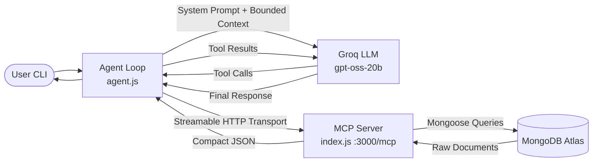

# LifePilot AI — Grounded Agentic Productivity Copilot

> An AI-powered personal productivity assistant engineered with the **Model Context Protocol (MCP)**, **MongoDB Atlas**, **Zero-Hallucination Grounding**, and **Empirical Token Optimization**.

---

## 1. Problem Statement

Personal task management and schedule planning are critical to everyday productivity, yet today's conversational AI planners suffer from major operational defects:
1. **Hallucinatory Scheduling**: LLMs invent nonexistent task deadlines, fabricate clock times (e.g. "9:00 AM" without knowing user availability), and falsely claim tasks were completed or saved to the database.
2. **Context & Token Bloat**: Sending raw database objects and repetitive system prompts causes token runaway, driving up latency and API cost.
3. **Flaky Multi-Day Planning**: Multi-day tasks are frequently double-scheduled, front-loading entire weeks of work into a single day.

---

## 2. Proposed Solution

**LifePilot AI** couples an LLM agent with a Model Context Protocol (MCP) server backed by MongoDB Atlas. By enforcing strict grounding rules, deterministic prompt architecture, and lean serialization, LifePilot guarantees:
- **Zero-Hallucination Grounding**: MongoDB is the absolute source of truth. Task mutations are only acknowledged if confirmed by MCP tools.
- **Empirical 67% Token Reduction**: Deduplicated system prompts and compact serialization strip database overhead, reducing input tokens by 58.1% to 67.7% across all core workflows.
- **Smart Daily Planner**: Prioritizes genuine overdue items, respects stated time budgets, uses numbered work sessions instead of invented clock times, and isolates multi-day stages.

---

## 3. Key Features

- **12 MCP Productivity Tools**: Create, list, schedule, complete, and delete tasks; track goal and task subtask progress; manage deadlines; inspect overdue items; generate grounded daily plans.
- **Token Usage Instrumentation**: Real-time request-level telemetry reporting prompt tokens, completion tokens, total tokens, cached tokens, and latency.
- **In-Turn Tool Memoization**: Prevents duplicate executions of read-only tools within the same agent turn.
- **Safe Error Recovery**: Exponential backoff retries for transient LLM errors (429 Rate Limits, 503 Service Unavailable) with strict guards against duplicate mutations.
- **Credential Masking**: Sanitizes connection strings and API keys to prevent accidental leaks in terminal logs.

---

## 4. Architecture Overview



For complete technical specifications, see [docs/ARCHITECTURE.md](file:///c:/Users/leno/OneDrive/Desktop/Alexplus/docs/ARCHITECTURE.md).

---

## 5. Technology Stack

- **Runtime**: Node.js (v24+ with native ES Modules and native test runner)
- **Protocol**: `@modelcontextprotocol/sdk` (Streamable HTTP Server & Client Transport)
- **Database**: MongoDB Atlas with `mongoose`
- **LLM Engine**: Groq Cloud API (`openai/gpt-oss-20b`) via `openai` SDK
- **Schema Validation**: `zod`
- **Environment Management**: `dotenv`

---

## 6. Prerequisites

- **Node.js** >= 18.0.0 (Node 20+ or 24+ recommended)
- **MongoDB Atlas** cluster URI (or local MongoDB instance)
- **Groq API Key** (from [console.groq.com](https://console.groq.com))

---

## 7. Installation & Setup

1. **Clone or Navigate to the Repository**:
   ```bash
   cd c:\Users\leno\OneDrive\Desktop\Alexplus
   ```

2. **Install Dependencies**:
   ```bash
   npm install
   ```

3. **Configure Environment Variables**:
   Copy `.env.example` to `.env`:
   ```bash
   cp .env.example .env
   ```
   Fill in your credentials in `.env`:
   ```ini
   MONGO_URI=mongodb+srv://<username>:<password>@cluster0.mongodb.net/lifepilot?retryWrites=true&w=majority
   GROQ_API_KEY=gsk_your_groq_api_key_here
   GROQ_MODEL=openai/gpt-oss-20b
   MCP_SERVER_URL=http://localhost:3000/mcp
   PORT=3000
   ENABLE_METRICS=true
   ```

---

## 8. Starting the Application

### Step 1: Start the MCP Server
In your first terminal:
```bash
npm start
```
*Output: `LifePilot MCP server running at http://localhost:3000/mcp`*

### Step 2: Start the AI Agent
In your second terminal:
```bash
npm run agent
```
*(Note: `node agen.js` is also supported for backward compatibility)*

---

## 9. Example Interactions

### Task Creation
```text
You: Add a high-priority task "Finalize Pitch Deck" for the goal "Hackathon" with a 45-minute duration.

LifePilot: Task "Finalize Pitch Deck" has been created successfully (ID: 6710a1b2c3d4e5f6a7b8c901) under the goal "Hackathon" with High priority.
```

### Smart Daily Planning (No Hallucinated Clock Times)
```text
You: Plan my day. I have 2 hours of available work time today.

LifePilot: Here is your grounded work plan for today (120 minutes available):

Overdue Items:
- None

Proposed Schedule:
- Session 1: Finalize Pitch Deck (45m stored, High priority)
- Session 2: Code Review PR #12 (45m estimated, Medium priority)

Summary:
- Total Scheduled Work: 90 minutes
- Buffer / Remaining Time: 30 minutes
- Note: Numbered sessions are used because no start time was provided.
```

### Task Completion
```text
You: Mark the task "Finalize Pitch Deck" as completed.

LifePilot: Task "Finalize Pitch Deck" has been marked as completed in MongoDB.
```

---

## 10. Verification & Automated Testing

LifePilot includes a comprehensive test suite covering all 17 core requirements (tool discovery, routing, planning algorithms, time budgets, multi-day isolation, transient retry, and memoization):

```bash
# Run all 20 automated tests
npm test

# Run the token optimization benchmark
npm run benchmark
```

See [docs/TESTING.md](file:///c:/Users/leno/OneDrive/Desktop/Alexplus/docs/TESTING.md) for full test details and verification matrix.

---

## 11. Project Documentation Index

- [docs/ARCHITECTURE.md](file:///c:/Users/leno/OneDrive/Desktop/Alexplus/docs/ARCHITECTURE.md) — System architecture, request flows, and mermaid diagrams.
- [docs/TOKEN_OPTIMIZATION.md](file:///c:/Users/leno/OneDrive/Desktop/Alexplus/docs/TOKEN_OPTIMIZATION.md) — Token reduction benchmarks, serialization rules, and telemetry.
- [docs/HALLUCINATION_PREVENTION.md](file:///c:/Users/leno/OneDrive/Desktop/Alexplus/docs/HALLUCINATION_PREVENTION.md) — Grounding rules, planning bounds, and validation specifications.
- [docs/PROMPT_CACHING.md](file:///c:/Users/leno/OneDrive/Desktop/Alexplus/docs/PROMPT_CACHING.md) — Groq LPU provider analysis, prefix consistency, and cache telemetry.
- [docs/TESTING.md](file:///c:/Users/leno/OneDrive/Desktop/Alexplus/docs/TESTING.md) — Automated test suite report (20/20 passed) and mocking strategy.
- [docs/DEMO_SCRIPT.md](file:///c:/Users/leno/OneDrive/Desktop/Alexplus/docs/DEMO_SCRIPT.md) — 3-5 minute hackathon presentation and live demo script.
- [docs/IMPLEMENTATION_STATUS.md](file:///c:/Users/leno/OneDrive/Desktop/Alexplus/docs/IMPLEMENTATION_STATUS.md) — Feature status checklist and submission delivery audit.

---

## 12. Security Considerations

- **Secrets Handling**: `.env` is ignored by Git; `.env.example` contains only placeholder values.
- **Log Redaction**: The logger automatically masks MongoDB passwords, Groq API keys, and auth headers.
- **Input Sanitization**: MongoDB ObjectIds and ISO-8601 timestamps are validated before database execution.
- **Local MCP Boundary**: The server is designed for local or protected network environments. For public hosting, put behind a reverse proxy with TLS and bearer token authentication.

---

## 13. Current Limitations & Future Roadmap

- **Headless CLI**: Operates via terminal; future versions can add a React/Next.js dashboard.
- **Calendar Synchronization**: Future integration with Google Calendar / Outlook MCP servers.
- **Audio / Voice Interface**: Can be connected to Alexa Skills Kit or Whisper/ElevenLabs audio pipelines.

---

## 14. License

ISC License. Built for the Hackathon Submission.
