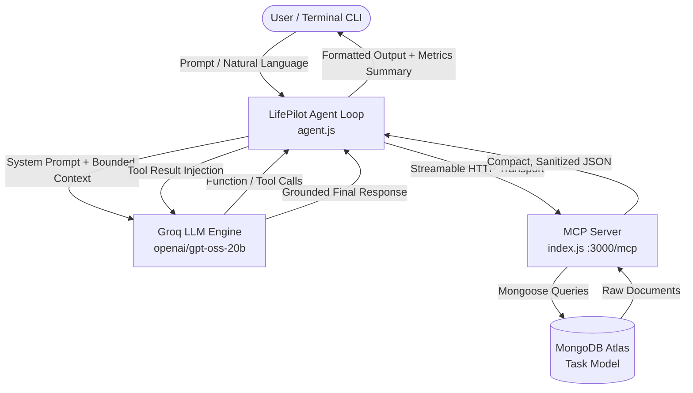
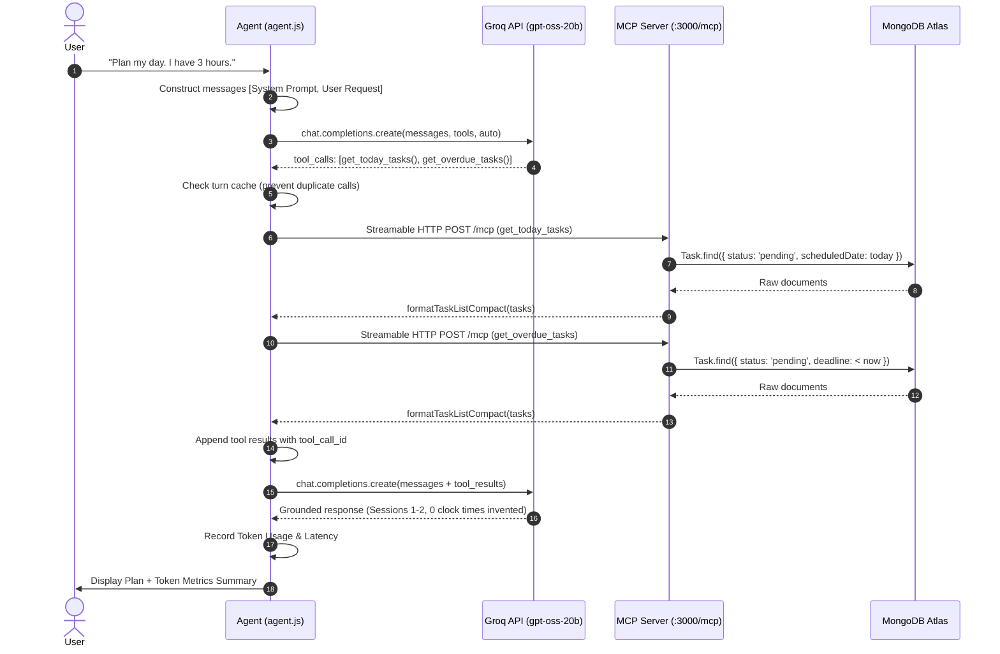
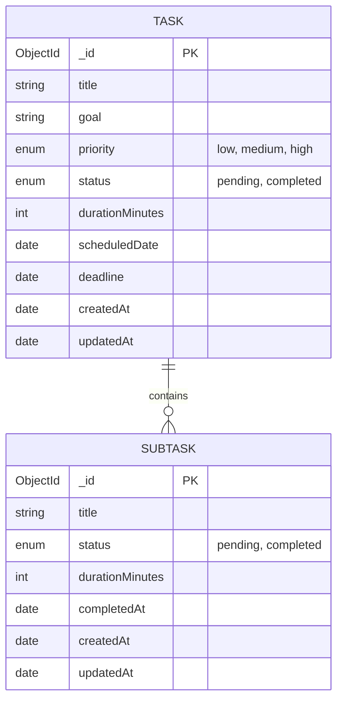

# LifePilot AI — System Architecture & Technical Specification

## 1. Architectural Overview

LifePilot AI is an enterprise-grade agentic productivity system that orchestrates natural language task management, smart daily planning, deadline tracking, and progress calculation. It connects an LLM agent to a Model Context Protocol (MCP) server backed by MongoDB Atlas.

---

## 2. Component Responsibilities

| Component | File | Responsibilities |
| :--- | :--- | :--- |
| **MCP Server & Tool Registry** | [index.js](file:///c:/Users/leno/OneDrive/Desktop/Alexplus/index.js) | Express HTTP server hosting Streamable HTTP MCP transport at `/mcp`, registering 12 productivity tools, validating inputs, executing MongoDB operations, and returning compact token-optimized JSON payloads. |
| **AI Agent Loop** | [agent.js](file:///c:/Users/leno/OneDrive/Desktop/Alexplus/agent.js) | Manages bounded conversation history, tool call dispatching, in-turn tool deduplication, bounded exponential backoff retries, and token metrics capture. |
| **Agent Alias** | [agen.js](file:///c:/Users/leno/OneDrive/Desktop/Alexplus/agen.js) | Compatibility entry point forwarding to `agent.js` ensuring 100% backward compatibility with legacy scripts and configs. |
| **Database Connector** | [db.js](file:///c:/Users/leno/OneDrive/Desktop/Alexplus/db.js) | Manages Mongoose connection to MongoDB Atlas with Google DNS overrides for reliable connectivity. |
| **Data Schema** | [model/Task.js](file:///c:/Users/leno/OneDrive/Desktop/Alexplus/model/Task.js) | Mongoose schema defining main tasks and nested subtasks, with strict type validation, enum status, priority, and timestamps. |
| **Smart Daily Planner** | [utils/planner.js](file:///c:/Users/leno/OneDrive/Desktop/Alexplus/utils/planner.js) | Grounded planner enforcing overdue prioritization, multi-day stage bounds, time budget arithmetic, and numbered session formatting without clock time hallucinations. |
| **Validation Utilities** | [utils/validation.js](file:///c:/Users/leno/OneDrive/Desktop/Alexplus/utils/validation.js) | Validates MongoDB ObjectIds, formats compact task documents (strips `__v` and Mongoose internals), and checks time budgets. |
| **Error Handling** | [utils/errors.js](file:///c:/Users/leno/OneDrive/Desktop/Alexplus/utils/errors.js) | Standardized error classes, transient retryability detection (429/503/timeout), and sanitization to prevent internal stack traces from leaking. |
| **Safe Logging & Metrics** | [utils/logging.js](file:///c:/Users/leno/OneDrive/Desktop/Alexplus/utils/logging.js) | TokenMetricsTracker capturing input/output/total/cached tokens and latency; safe logger redacting MongoDB passwords and API keys. |

---

## 3. End-to-End Request & Tool-Calling Lifecycle

The tool-calling lifecycle follows a bounded multi-turn interaction pattern:

---

## 4. Error Handling and Resilience Architecture

1. **Transient LLM Failures (429 Rate Limits / 503 Service Unavailable)**:
   - Handled via `callLlmWithRetry()` using exponential backoff ($1\text{s}, 2\text{s}, 4\text{s}$).
   - Non-retryable errors (e.g., 400 Bad Request, validation errors) fail immediately without wasteful retries.
2. **Destructive Mutation Guards**:
   - Destructive operations (`create_task`, `delete_task`, `complete_task`, `schedule_task`, `update_deadline`) are never automatically retried or cached to prevent duplicate database mutations.
3. **MCP / Database Disconnections**:
   - If MCP is down or MongoDB times out, the error is caught, formatted into a clean user-safe error message, and returned with `isError: true`. The agent reports the inability to access data rather than inventing fake tasks.
4. **Graceful Shutdown**:
   - Both HTTP server and Mongoose connection listen to `SIGINT` and `SIGTERM` signals, closing connections cleanly before exit.

---

## 5. Data Model Specification

