# LifePilot AI — Token Optimization Technical Report

## 1. Executive Summary

Token efficiency directly determines inference latency, operating cost, and context degradation in production LLM applications. An audit of the initial LifePilot codebase identified major sources of token bloat:
1. **Redundant Prompt Instructions**: The legacy system prompt was 2,447 tokens long and contained duplicate sections (Section 7 was included twice with conflicting phrasing).
2. **Raw Database Document Leaks**: Mongoose documents returned raw internal metadata (`__v`, internal getters, `$isNew`, `createdAt`/`updatedAt` on every subtask), consuming unnecessary tokens.
3. **Unbounded Conversation History**: The interactive loop accumulated messages unbounded, causing linear token inflation with each user turn.
4. **Duplicate Tool Executions**: LLMs occasionally emitted identical tool calls within the same turn.

Through targeted architectural improvements, LifePilot achieved an empirical **58.1% to 67.7% reduction in token consumption** across all primary workflows.

---

## 2. Implemented Optimizations

### A. System Instruction Compaction & De-duplication
- **Before**: 2,447 tokens (9,419 characters), containing duplicated planning rules and verbose prose.
- **After**: 788 tokens (3,032 characters) in [agent.js](file:///c:/Users/leno/OneDrive/Desktop/Alexplus/agent.js).
- **Impact**: **-1,659 tokens (-67.8%) saved on every single LLM request**.
- **Stability**: Placed deterministically as the initial system message to allow provider prefix caching to operate.

### B. Compact Serialization & Projection (`formatTaskCompact`)
In [utils/validation.js](file:///c:/Users/leno/OneDrive/Desktop/Alexplus/utils/validation.js):
- Strips MongoDB internal fields (`__v`, `$isNew`, `_doc`, Mongoose prototype methods).
- Normalizes ISO-8601 strings and compacts subtasks.
- Employs `.lean()` in queries to avoid Mongoose overhead.
- **Impact**: On a 5-task payload, tool result tokens dropped from 872 tokens to 593 tokens (**-32.0% token reduction**).

### C. In-Turn Tool Call Deduplication
In [agent.js](file:///c:/Users/leno/OneDrive/Desktop/Alexplus/agent.js):
- Maintains an in-turn cache of read-only tool calls (`${toolName}:${JSON.stringify(args)}`).
- If an LLM calls `list_tasks` or `get_today_tasks` with identical arguments within the same turn, the result is served from memory.
- Guards prevent destructive tools (`create_task`, `delete_task`, `complete_task`) from being cached.

### D. Bounded Conversational Context
- Terminal message history is strictly bounded using a sliding window (`MAX_HISTORY_MESSAGES = 10`), retaining the immutable system prompt and the current query.
- Prevents context drift and cost runaway during prolonged sessions.

---

## 3. Empirical Benchmark & Before-and-After Measurements

We executed the reproducible benchmark script (`node tests/benchmark.js`) against representative task workloads. Below are the measured results:

| Evaluation Scenario | Baseline Tokens | Optimized Tokens | Token Savings | Percentage Reduction |
| :--- | :---: | :---: | :---: | :---: |
| **Simple Greeting** (`"Hello!"`) | 2,462 | 803 | -1,659 | **-67.4%** |
| **Create Task** (`"Add task Buy Groceries"`) | 2,672 | 933 | -1,739 | **-65.1%** |
| **List Tasks** (`"What tasks do I have?"`) | 3,334 | 1,396 | -1,938 | **-58.1%** |
| **Plan My Day** (`"Plan my day with 3 hours"`) | 2,911 | 1,172 | -1,739 | **-59.7%** |
| **Task Progress** (`"Show progress for Task #1"`) | 2,569 | 830 | -1,739 | **-67.7%** |

```mermaid
xychart-beta
    title "Token Consumption: Baseline vs Optimized Implementation"
    x-axis ["Greeting", "Create Task", "List Tasks", "Plan My Day", "Task Progress"]
    y-axis "Input Tokens" 0 --> 3500
    bar [2462, 2672, 3334, 2911, 2569]
    bar [803, 933, 1396, 1172, 830]
```



---

## 4. Request-Level Token Usage Instrumentation

All LLM requests pass through the `TokenMetricsTracker` in [utils/logging.js](file:///c:/Users/leno/OneDrive/Desktop/Alexplus/utils/logging.js). When enabled (`ENABLE_METRICS=true`), it outputs a clean execution summary:

```text
================ [TOKEN USAGE & METRICS] ================
 Model:            openai/gpt-oss-20b
 LLM Requests:     2
 Tool Calls:       1
 Input Tokens:     933
 Output Tokens:    45
 Total Tokens:     978
 Cached Tokens:    0 (Provider does not report cache/unsupported)
 Latency:          412ms
=========================================================
```

### Metrics Captured:
1. `promptTokens`: Total input tokens processed across the turn.
2. `completionTokens`: Output tokens generated (including reasoning tokens).
3. `totalTokens`: Sum of prompt and completion tokens.
4. `cachedPromptTokens`: Cached tokens read from provider response metadata.
5. `requestCount`: Number of LLM round-trips.
6. `toolCallsCount`: Number of MCP tools invoked.
7. `durationMs`: Wall-clock latency.
